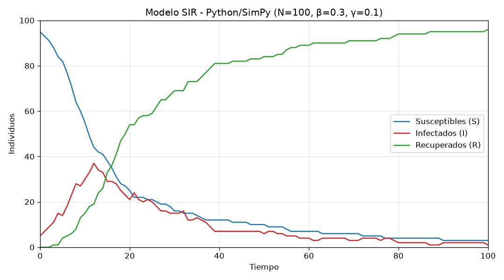

# Simulación SIR con Python y SimPy

Implementación en Python del modelo epidemiológico **SIR** (Susceptibles, Infectados, Recuperados) de la **Práctica 04 de Simulación**: *Análisis comparativo de herramientas de simulación mediante un modelo común*. El programa simula la propagación de una infección en una población de 100 individuos y genera `resultados_python.csv` y una gráfica de S(t), I(t) y R(t).

> Este repositorio cubre **solo la implementación en Python**. Los modelos de NetLogo y Java, la importación de los CSV en NetLogo y la tabla comparativa no forman parte de él.

## Inicio rápido

Requisitos: Python 3.12 o superior (lo exige NumPy 2.5).

```bash
cd python
python3 -m venv .venv
source .venv/bin/activate
pip install -r requirements.txt

python main.py
```

Salida esperada:

```text
R0 = beta / gamma = 3.0
Pico de infectados: 37 en t = 12
Estado final (t = 100): S=3 I=1 R=96
CSV: resultados_python.csv | Grafica: grafica_python.png
```

Para ejecutar las pruebas:

```bash
python -m unittest
```

### Opciones

| Opción | Valor por defecto | Descripción |
|--------|-------------------|-------------|
| `--semilla` | `42` | Semilla de los números aleatorios. Con la misma semilla siempre se obtiene el mismo resultado. |
| `--csv` | `resultados_python.csv` | Ruta del archivo CSV de salida. |
| `--grafica` | `grafica_python.png` | Ruta de la imagen de la gráfica. |

Ejemplo: `python main.py --semilla 7`

## Parámetros del modelo

| Parámetro | Valor |
|-----------|-------|
| Población (N) | 100 |
| Infectados iniciales | 5 |
| Susceptibles iniciales | 95 |
| β (tasa de infección) | 0.30 |
| γ (tasa de recuperación) | 0.10 |
| Tiempo de simulación | 100 |
| R₀ = β / γ | 3 |

Los parámetros se definen en `python/parametros.py`.

## Cómo funciona

La simulación avanza en pasos discretos de tiempo, de `t = 0` a `t = 100`. En cada paso:

1. Se cuentan los individuos en cada estado y se guarda la fila `(tiempo, S, I, R)`.
2. Cada **infectado** elige al azar a otro individuo como contacto. Si el contacto es **susceptible**, se contagia cuando un número aleatorio entre 0 y 1 es menor que **β**.
3. Cada **infectado** se recupera cuando un número aleatorio entre 0 y 1 es menor que **γ**.
4. Todos los cambios se aplican al mismo tiempo al final del paso, lo que equivale a la "copia del estado actual" del pseudocódigo. Un individuo contagiado en el paso `t` empieza a contagiar en el paso `t + 1`.

SimPy controla el reloj de la simulación: el proceso registra, aplica las reglas y espera una unidad de tiempo con `yield env.timeout(1)`.

**Relación con las ecuaciones diferenciales.** Cada infectado tiene un único contacto por paso, por lo que la probabilidad de que ese contacto sea susceptible es aproximadamente S/N. Los contagios esperados por paso son β · S · I / N, el mismo término de `dS/dt = -β·S·I/N`, y las recuperaciones esperadas son γ · I, como en `dR/dt = γ·I`.

## Estructura del código

Cada clase está en su propio archivo y tiene una sola responsabilidad.

| Archivo | Clase | Responsabilidad |
|---------|-------|-----------------|
| `parametros.py` | `ParametrosSIR` | Guarda la configuración del modelo y calcula R₀. |
| `estado.py` | `Estado` | Define los estados S, I y R. |
| `individuo.py` | `Individuo` | Guarda y cambia el estado de una persona. |
| `poblacion.py` | `Poblacion` | Contiene a los individuos y cuenta cuántos hay en cada estado. |
| `modelo_sir.py` | `ModeloSIR` | Aplica las reglas de contagio y recuperación en un paso. |
| `registro.py` | `RegistroSIR` | Almacena los valores de S, I y R en cada tiempo. |
| `simulacion.py` | `SimulacionSIR` | Controla el tiempo de la simulación con SimPy. |
| `exportador_csv.py` | `ExportadorCSV` | Escribe los resultados en un archivo CSV. |
| `graficador.py` | `GraficadorSIR` | Genera la gráfica de S, I y R. |
| `main.py` | — | Conecta las clases y ejecuta el programa. |
| `test_modelo_sir.py` | — | Pruebas unitarias. |

```text
main.py
 └─ SimulacionSIR ──(cada paso)──► ModeloSIR ──► Poblacion ──► Individuo
        │
        └─► RegistroSIR ──► ExportadorCSV  (resultados_python.csv)
                       └──► GraficadorSIR  (grafica_python.png)
```

## Resultados

Formato de `resultados_python.csv` (101 filas de datos, de `t = 0` a `t = 100`):

```csv
tiempo,susceptibles,infectados,recuperados
0,95,5,0
1,93,7,0
2,91,9,0
```

Con la semilla 42:

| Indicador | Valor |
|-----------|-------|
| Pico de infectados | 37 en `t = 12` |
| Estado final | S = 3, I = 1, R = 96 |



Con R₀ = 3, el modelo teórico predice que alrededor del 94 % de la población se infecta durante la epidemia. En la simulación se infecta el 97 %, porque al final hay 96 recuperados y 1 infectado.

### Efecto de los números aleatorios

El modelo es estocástico: cada contagio y cada recuperación depende de un número aleatorio. La semilla fija esa secuencia de números, así que:

- La misma semilla produce siempre los mismos resultados.
- Otra semilla (`--semilla 7`) produce una curva distinta con el mismo modelo y los mismos parámetros.
- Otras herramientas, como Java o NetLogo, usan generadores de números aleatorios diferentes. Por eso pueden dar resultados distintos aunque implementen el mismo modelo.

## Pruebas

`python -m unittest` ejecuta 11 pruebas que verifican que:

- Se registran los tiempos de 0 a 100.
- El estado inicial es S = 95, I = 5, R = 0.
- La población total se mantiene en 100 en todo momento.
- Los susceptibles nunca aumentan y los recuperados nunca disminuyen.
- La misma semilla produce los mismos resultados.
- Un individuo nunca se elige a sí mismo como contacto.
- El CSV tiene el encabezado y las filas correctas.
